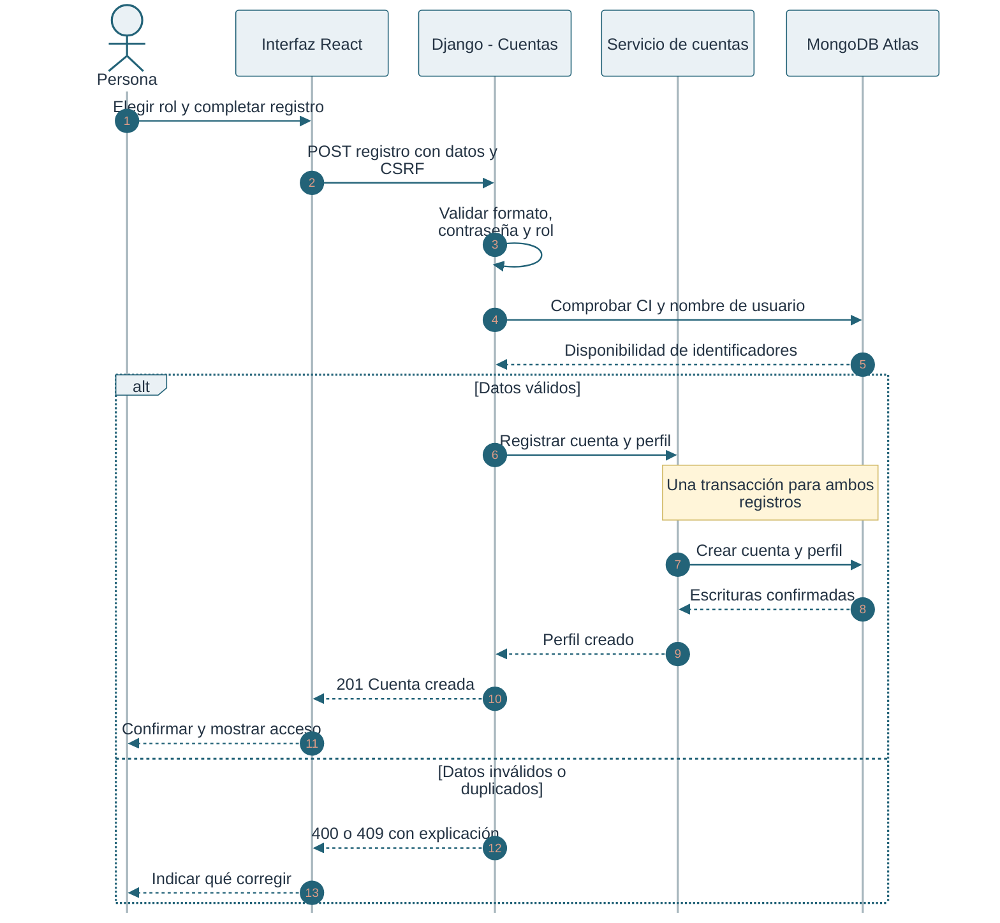
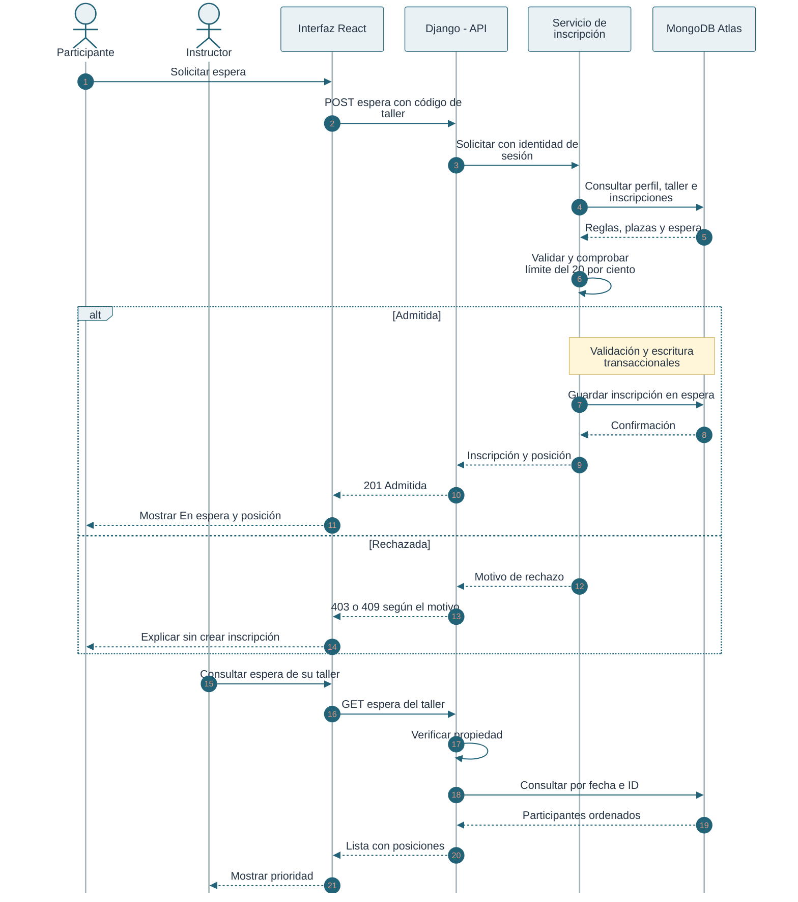
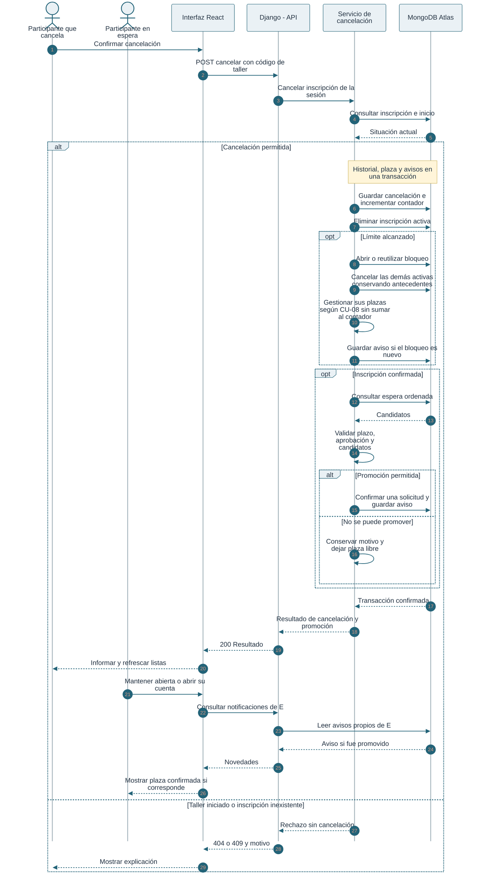
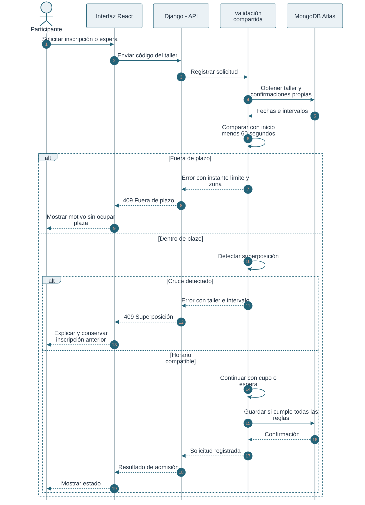
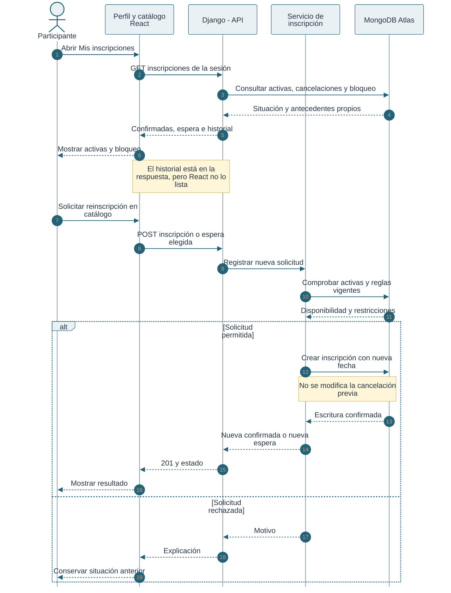
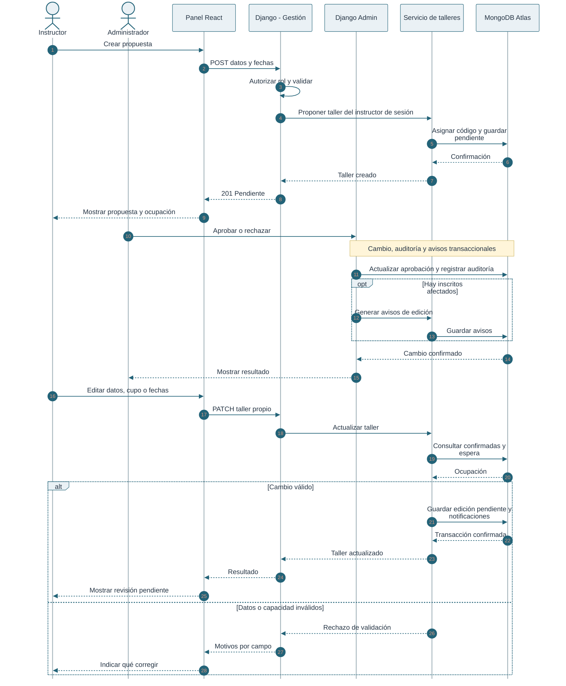
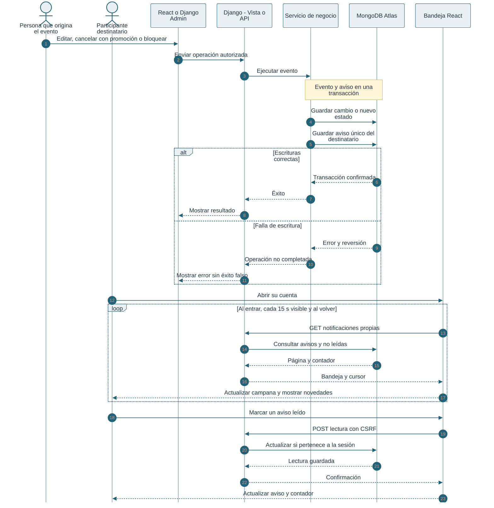
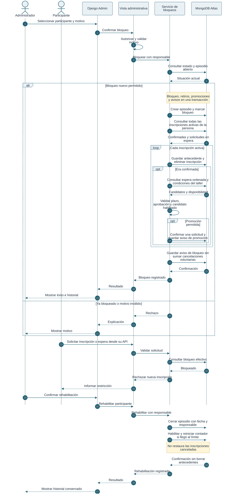
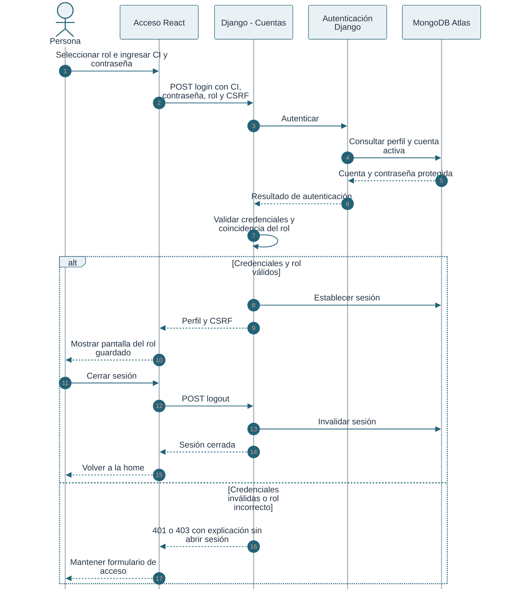
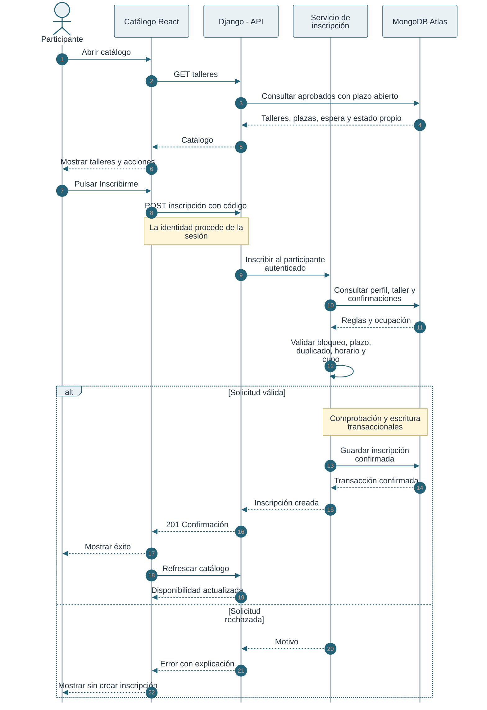

# join.a.workshop
## Documentación final del proyecto

**Sistema web de inscripción y gestión de talleres**<br>
**Integrantes:** Marcos Domínguez, Katrina Leigue e Ismael Díaz.<br>
**Fecha de revisión:** 30 de octubre de 2026.<br>
**Versión documentada:** `main`, commit `ad57ac5`, que incorpora las notificaciones, la suite de 90 pruebas y los cambios de acceso por rol y cancelación por bloqueo del PR #73.<br>

> Este documento describe la aplicación web implementada. Relaciona los casos de uso con las issues originales y distingue el alcance inicial del comportamiento comprobado en el código. Una tarjeta cerrada o abierta en GitHub no acredita por sí sola que una función esté terminada o pendiente.

## Índice

1. [Presentación del proyecto](#1-presentación-del-proyecto)
2. [Roles y alcance](#2-roles-y-alcance)
3. [Requisitos funcionales](#3-requisitos-funcionales)
4. [Reglas de negocio](#4-reglas-de-negocio)
5. [Arquitectura y almacenamiento](#5-arquitectura-y-almacenamiento)
6. [Casos de uso](#6-casos-de-uso)
7. [Flujos web complementarios](#7-flujos-web-complementarios)
8. [Interfaz y demostración](#8-interfaz-y-demostración)
9. [Instalación y ejecución](#9-instalación-y-ejecución)

## 1. Presentación del proyecto

**join.a.workshop** permite ofrecer talleres con cupos limitados y gestionar el recorrido de una persona: registrarse, consultar talleres aprobados, inscribirse, ingresar a una lista de espera, cancelar y recibir información sobre los cambios que le afectan.

El nombre alude a los **JOIN de bases de datos** y a la unión entre quienes quieren aprender y quienes quieren compartir conocimientos. Los dos anillos entrelazados del logo representan esa conexión. La identidad visual utiliza verdes, fondos cálidos y un estilo común para la home, las cuentas, el catálogo y el panel del instructor.

El proyecto aborda problemas de la gestión manual: duplicados, sobreocupación, dudas sobre la prioridad de la espera, pérdida de antecedentes y falta de comunicación cuando cambia un taller o se libera una plaza.

El instructor propone y edita sus talleres; el administrador revisa las propuestas y gestiona bloqueos; el participante opera sobre sus propias inscripciones. React presenta las pantallas, Django valida y ejecuta las operaciones y MongoDB Atlas conserva los datos.

### Equipo

| Integrante | Cuenta en el repositorio |
| --- | --- |
| Marcos Domínguez | `marcosedominguez-cyber` |
| Katrina Leigue | `katcker707` |
| Ismael Díaz | `ismael8688` |

Las asignaciones de las issues sirven como referencia de organización. No atribuyen de forma exclusiva cada módulo: la entrega integra cambios de los tres integrantes.

## 2. Roles y alcance

| Rol | Acciones principales |
| --- | --- |
| Participante | Registrarse, iniciar sesión, consultar catálogo, inscribirse, solicitar espera, consultar activas, cancelar y leer notificaciones. |
| Instructor | Registrarse, proponer talleres, consultar y editar los propios, ver ocupación y consultar su lista de espera. |
| Administrador | Acceder a Django Admin, revisar propuestas, aprobar/rechazar, administrar participantes, bloquear/rehabilitar y consultar antecedentes y auditoría. |

**Operador y coordinador no son perfiles web separados en esta versión.** Las fichas iniciales utilizaban esos actores y un menú de terminal. En la web el participante registra su propia solicitud y cancelación, el instructor propone talleres y el administrador decide su aprobación. No existe una API de React para que un operador cancele en nombre de otra persona.

El selector Participante/Instructor se utiliza en el registro y en el acceso. Django comprueba que el rol seleccionado al iniciar sesión coincida con el perfil real antes de abrir la sesión; si no coincide, rechaza el acceso. Los permisos efectivos provienen del perfil guardado y de la sesión. Las cuentas administrativas acceden por Django Admin.

El menú Python de `proyecto/main.py` se conserva como interfaz histórica y de compatibilidad. Esta documentación se centra en React y Django Admin.

## 3. Requisitos funcionales

Se conservan los ocho requisitos originales, con sus identificadores y su redacción. La columna de comportamiento describe cómo se atienden en la versión web; los casos de uso desarrollan sus reglas y límites.

| ID | Requisito original | Comportamiento en la versión web | Referencia |
| --- | --- | --- | --- |
| TAL-01 | Registrar talleres y participantes con identificadores únicos. | Registro de participantes con CI única y propuesta de talleres con código único. Los talleres requieren revisión administrativa para su publicación. | CU-01 y CU-06 |
| TAL-02 | Consultar talleres, fechas, cupos y disponibilidad. | Catálogo de talleres aprobados con plazo abierto, fechas, cupo y disponibilidad; incluye talleres llenos para solicitar espera. | F-02 y CU-06 |
| TAL-03 | Registrar una inscripción y asignar el estado que corresponda. | Registrar una inscripción confirmada cuando hay plaza o una solicitud en espera cuando corresponde; comunicar el resultado al participante. | F-02 y CU-02 |
| TAL-04 | Evitar duplicados y aplicar las condiciones de inscripción. | Validar identidad, aprobación del taller, plazo, superposición de horarios, bloqueo, duplicados y capacidad antes de aceptar una solicitud. | CU-02, CU-04 y CU-08 |
| TAL-05 | Cancelar una inscripción y gestionar la plaza liberada. | Cancelar antes del inicio, conservar el antecedente y promover como máximo a una persona cuando se libera una plaza confirmada y se cumplen las condiciones de promoción. | CU-03 |
| TAL-06 | Mantener una lista de espera y promover participantes según la política acordada. | Limitar la espera al 20 % del cupo redondeado hacia abajo; ordenar por fecha, hora e identificador y promover a la primera persona habilitada sin superar el cupo. | CU-02 y CU-03 |
| TAL-07 | Corregir datos o cambiar el cupo conservando motivo e historial. | Permitir al instructor editar sus talleres y al administrador revisar sus datos y aprobación. La auditoría administrativa registra los cambios; los detalles y límites de la conservación de motivos e historial se explican en el caso de uso. | CU-06 |
| TAL-08 | Mostrar listas de confirmados, espera, cancelaciones y resumen de ocupación. | Consultar inscripciones propias, espera ordenada, cancelaciones por API/Admin y resumen de ocupación. La disponibilidad de cada consulta depende del rol y de la interfaz. | CU-02, CU-05 y CU-06 |

**Funcionalidades adicionales:** la versión web incorpora autenticación y permisos, notificaciones de edición, promoción y bloqueo, bloqueo y rehabilitación de participantes y protección de los datos históricos frente al borrado administrativo. Se explican en sus casos de uso y en los flujos complementarios, sin modificar la numeración original de los requisitos.

**Cobertura que debe distinguirse:** el historial de cancelaciones está almacenado y disponible por API/Admin, pero no se lista en el perfil React. El instructor dispone de ocupación y espera, pero no de una pantalla nominal de confirmados.

## 4. Reglas de negocio

| ID | Regla vigente |
| --- | --- |
| RN-01 | CI web única de 1 a 20 dígitos, sin puntos ni guiones; nombre de usuario también único. |
| RN-02 | ObjectId como identidad interna. Talleres con código visible consecutivo como `T-001`. Las cuentas web actuales no reciben códigos `P-001`. |
| RN-03 | Cupo entero entre **4 y 40** participantes. |
| RN-04 | Fin posterior al inicio; duración de **24 horas a 7 días**, incluidos ambos límites. |
| RN-05 | Propuestas nuevas y ediciones del instructor quedan pendientes de aprobación. Solo las aprobadas se publican en catálogo. |
| RN-06 | Inscripción y espera hasta el instante exacto de un minuto antes del inicio: para las 12:00, se admite `11:59:00` y se rechaza `11:59:01`. |
| RN-07 | Máximo una inscripción activa por participante y taller: confirmada o en espera. Solo las confirmadas consumen plaza. |
| RN-08 | La espera se solicita expresamente para un taller lleno. Capacidad `cupos // 5`: 20 % redondeado hacia abajo. Cupo 4 → espera 0; cupo 10 → espera 2; cupo 40 → espera 8. |
| RN-09 | Prioridad por `fecha_solicitud` ascendente y ObjectId ascendente ante empate. El desempate es determinista, no una garantía temporal entre peticiones simultáneas. |
| RN-10 | Cruce horario si `inicioA < finB` e `inicioB < finA`. Se comparan otras confirmadas de la persona. Intervalos adyacentes se permiten. |
| RN-11 | La cancelación voluntaria se permite mientras `ahora < fecha_inicio`; al inicio o después, se rechaza. El retiro forzado por bloqueo también cancela inscripciones de talleres ya iniciados. |
| RN-12 | Por cada plaza confirmada liberada se promueve como máximo a una persona habilitada. La selección omite candidatos bloqueados o con horarios incompatibles y conserva el orden relativo de las solicitudes restantes. |
| RN-13 | La promoción también comprueba aprobación y RN-06. Durante el último minuto puede aceptarse la cancelación sin promover. |
| RN-14 | Cancelar elimina la inscripción activa y crea un antecedente en `cancelaciones`; no agrega un estado `cancelada` a la fila activa. Reinscribirse crea otra inscripción. |
| RN-15 | Cada cancelación voluntaria incrementa el contador disciplinario. Con **3 cancelaciones** se abre o reutiliza un bloqueo automático. Los retiros forzados por bloqueo no aumentan ese contador. |
| RN-16 | El bloqueo impide nuevas inscripciones, espera y promociones para esa persona y cancela todas sus confirmadas y solicitudes en espera, conservando antecedentes. Las plazas liberadas se gestionan según las reglas de promoción. Rehabilitar cierra el episodio y reinicia el contador si llegó al límite; no restaura inscripciones ni borra antecedentes. |
| RN-17 | Una reducción de cupos debe permitir conservar confirmadas y espera dentro de sus límites. Aumentar cupos no promueve por sí solo. |
| RN-18 | Evento y notificación se guardan en la misma transacción. Ante falla se revierten; una clave de evento por participante evita duplicados. |
| RN-19 | Fechas conscientes de zona horaria. La aplicación utiliza `America/La_Paz`; la bandeja formatea sus fechas según el navegador. |

Los servicios reintentan hasta cinco veces errores de MongoDB identificados como transitorios. Un rechazo de negocio no crea la solicitud ni un aviso de éxito falso. El cambio de prioridad absoluta a prioridad entre habilitados y el cierre de promoción antes del inicio son decisiones implementadas que se explicitan en cada caso.

## 5. Arquitectura y almacenamiento

### 5.1 Componentes

| Componente | Responsabilidad | Ubicación |
| --- | --- | --- |
| React | Home, acceso, catálogo, Mis inscripciones, notificaciones y panel del instructor. | `frontend/src/` |
| Cliente HTTP | JSON, cookies de sesión y token CSRF para escrituras. | `frontend/src/api.js` |
| API Django | Sesión, rol, método, entrada y traducción de resultados a HTTP. | `cuentas/vistas.py`, `talleres/api_*.py` |
| Servicios | Ejecutar los casos de uso persistentes y sus transacciones. | `cuentas/servicios.py`, `talleres/servicios.py` |
| Reglas y consultas | Límites, horarios, disponibilidad, prioridad y lecturas. | `talleres/reglas.py`, `talleres/consultas.py` |
| Django Admin | Revisión, bloqueos, antecedentes y auditoría. | `talleres/admin.py`, `talleres/admin_site.py` |
| MongoDB Atlas | Documentos, referencias, índices y transacciones. | Modelos y migraciones mediante `django-mongodb-backend`. |

Una operación recorre persona → React/Admin → vista Django → servicio → modelos/Atlas → respuesta → interfaz. Las lecturas pueden pasar directamente por las consultas, sin un servicio de escritura.

### 5.2 Colecciones del dominio

| Colección | Datos principales |
| --- | --- |
| `participantes` | Perfiles `Usuario` de los tres roles, CI, cuenta, contador y bloqueo. El nombre histórico de la colección no limita los roles almacenados. |
| `talleres` | Código, contenido, cupo, fechas, instructor y aprobación. |
| `inscripciones` | Participante, taller, estado activo y fecha de solicitud. |
| `cancelaciones` | Participante/taller, código y nombre del taller, estado anterior y fecha. |
| `bloqueos` | Motivo, participante, fechas y responsables de bloqueo/rehabilitación. |
| `notificaciones` | Destinatario, categoría, título, mensaje, evento, fecha, lectura y taller opcional. |
| `contadores` | Secuencia de códigos de talleres. |

Django conserva también cuentas, sesiones, permisos y auditoría. `django_admin_log` permite consultar las acciones administrativas; `change_message` contiene los campos y valores modificados desde la incorporación de esa auditoría.

### 5.3 Seguridad e integridad

- Identidad obtenida de sesión para inscripción, cancelación y notificaciones; no se acepta la CI de un tercero enviada por el cliente.
- Propiedad del taller comprobada en las operaciones del instructor.
- Registro público sin posibilidad de crear administradores o enviar banderas de privilegios.
- Contraseñas protegidas por Django y escrituras web con CSRF.
- Admin exige cuenta activa, `is_staff=True` y perfil `administrador`; ser superusuario no sustituye el perfil.
- Admin no permite borrar usuarios, talleres ni inscripciones; las inscripciones, cancelaciones y episodios de bloqueo se consultan sin editar directamente sus estados.
- Cada persona solo puede consultar y marcar sus propias notificaciones.
- Transacciones y escrituras compartidas sobre taller/participante coordinan peticiones concurrentes; los índices únicos refuerzan la integridad.

## 6. Casos de uso

Se identificaron **ocho casos de uso**, asociados a las issues #1, #2, #3, #4, #21, #31, #25 y #65. La numeración de lectura `CU-01` a `CU-08` no sustituye los números originales de GitHub.

**Cada CU tiene su propio diagrama.** Son diagramas de secuencia con carriles/líneas de vida, siguiendo la referencia visual: actor, interfaz, Django, servicio y Atlas. Están escritos en Mermaid para conservarlos editables y renderizarlos en GitHub. Flechas continuas: solicitudes; discontinuas: respuestas; `alt`: alternativas; `loop`: repetición.

### CU-01. Registrar una cuenta de participante o instructor

**Origen:** [Registrar participantes — issue #1](https://github.com/marcosedominguez-cyber/Inscripcion-Talleres-Django/issues/1).<br>
**Objetivo:** crear una cuenta y su perfil para operar en la web.<br>
**Actor:** visitante que elige participante o instructor.<br>
**Precondiciones:** no tener una sesión abierta y disponer de conexión a la base.

**Historia:** como persona interesada, quiero registrarme para inscribirme a talleres o proponerlos según mi rol.

**Flujo principal**

1. Abre registro, selecciona rol e ingresa nombre de usuario, CI, contraseña y confirmación.
2. React comprueba la coincidencia de contraseñas y envía el formulario.
3. Django valida formato de CI, unicidad de CI/usuario, contraseña y rol público permitido.
4. El servicio crea cuenta y perfil dentro de una transacción.
5. La interfaz confirma el registro y dirige al acceso. Registrarse no abre sesión automáticamente.

**Alternativas:** datos vacíos o inválidos, contraseñas distintas, identificadores duplicados, rol no permitido o fallo de conexión. Una falla transaccional no deja una cuenta sin perfil.

**Resultado:** cuenta y perfil persistentes. **Adaptación de la ficha:** el operador y el código antiguo `P-001` se sustituyen en la web por registro autónomo, CI única y cuenta asociada.



### CU-02. Gestionar lista de espera

**Origen:** [Issue #2](https://github.com/marcosedominguez-cyber/Inscripcion-Talleres-Django/issues/2).<br>
**Objetivo:** admitir una solicitud en un taller lleno o informar por qué se rechaza.<br>
**Actores:** participante solicitante e instructor que consulta su lista.<br>
**Precondiciones:** sesión del rol correspondiente, taller existente y plazo abierto.

**Historias:** el participante quiere solicitar espera y conocer el resultado; quien gestiona el taller quiere conocer la prioridad de las solicitudes.

**Flujo principal**

1. El catálogo muestra el taller lleno y, si hay espacio, Entrar en lista de espera.
2. El participante solicita ingreso y Django obtiene su identidad desde la sesión.
3. El servicio valida bloqueo, aprobación, plazo, duplicados y superposición.
4. Comprueba que no hay plazas y que la espera no alcanzó `cupos // 5`.
5. Guarda `en_espera`, con fecha y prioridad determinable; devuelve admisión y posición.
6. React actualiza la tarjeta. El instructor consulta la lista de sus propios talleres con posición, nombre y fecha.

**Alternativas:** espera llena, taller con plazas, duplicado, bloqueo, horario incompatible o plazo vencido. Cupo cuatro implica espera cero. No se autoriza consultar un taller ajeno.

**Resultado:** solicitud persistente y ordenada, o rechazo sin alterar la lista previa. La posición se calcula al consultar y puede avanzar cuando otras personas salen.



### CU-03. Cancelación y promoción automática

**Origen:** [Issue #3](https://github.com/marcosedominguez-cyber/Inscripcion-Talleres-Django/issues/3).<br>
**Objetivo:** registrar el retiro y gestionar la plaza liberada sin superar el cupo.<br>
**Actores:** participante que cancela y participante en espera que podría recibir la plaza.<br>
**Precondiciones:** inscripción activa y taller no iniciado.

**Historias:** registrar el retiro, respetar la prioridad de la espera y conocer el resultado.

**Flujo principal**

1. En Mis inscripciones se elige Cancelar inscripción y se confirma en el diálogo.
2. Django valida identidad, taller, inscripción y que el inicio no haya llegado.
3. El servicio crea `Cancelacion`, incrementa el contador y elimina la inscripción activa.
4. Si llega al límite disciplinario, registra el bloqueo, cancela las demás inscripciones confirmadas y solicitudes en espera, conserva sus antecedentes y guarda el aviso. Estos retiros forzados no incrementan el contador y sus plazas se gestionan según las reglas de promoción.
5. Si era confirmada, revisa aprobación/plazo de promoción y recorre la espera por fecha/ID.
6. Omite bloqueados o incompatibles y confirma como máximo al primero habilitado. Conserva el orden relativo del resto.
7. Guarda el aviso de promoción en la misma transacción.
8. Devuelve cancelación y resultado; React refresca las listas y el catálogo.

**Alternativas:** Volver cierra el diálogo sin cancelar; cancelar espera no promueve; sin candidatos habilitados queda una plaza libre; fuera del plazo de promoción se conserva la cancelación y se explica la ausencia de promoción. Taller iniciado o inscripción inexistente producen rechazo.

**Resultado:** antecedente persistente y, cuando corresponde, una promoción. Una falla transaccional revierte historial, estado y avisos.

**Diferencias con el alcance inicial:** se promueve al primero habilitado, no necesariamente al primero absoluto. Durante el último minuto puede no haber promoción. El cancelante recibe el resultado general, no la identidad del promovido; esa relación no se persiste en `Cancelacion`, pero quien recibe la plaza tiene su notificación.



### CU-04. Validación de horarios y plazos

**Origen:** [Issue #4](https://github.com/marcosedominguez-cyber/Inscripcion-Talleres-Django/issues/4).<br>
**Objetivo:** impedir solicitudes fuera de plazo o confirmaciones incompatibles.<br>
**Actor:** participante que solicita inscripción o espera. La validación también se usa al promover.<br>
**Precondiciones:** sesión válida y taller con fechas válidas.

**Flujo principal**

1. El servidor toma su hora actual; el cliente no puede enviarla para ampliar el plazo.
2. Comprueba `ahora <= inicio - 60 segundos`.
3. Consulta otras confirmaciones de esa persona, excluyendo el mismo taller.
4. Compara intervalos completos, con fecha y zona horaria.
5. Si no hay cruce, continúa con disponibilidad y registro. En caso contrario, devuelve el motivo y el taller o límite que impide la solicitud.

**Ejemplos:** inicio a las 12:00 admite 11:59:00 y rechaza 11:59:01. Si un taller termina exactamente cuando empieza otro, se permite. Una cancelación anterior no bloquea por horario porque ya no es una confirmación activa.

**Resultado:** continuación o rechazo sin ocupar plaza ni perder la confirmación anterior. El catálogo usa la misma regla temporal y conserva talleres llenos para ofrecer espera.



### CU-05. Consultas, historial y reinscripción

**Origen:** [Issue #21](https://github.com/marcosedominguez-cyber/Inscripcion-Talleres-Django/issues/21).<br>
**Objetivo:** consultar la situación propia y permitir una solicitud nueva tras cancelar, conservando antecedentes.<br>
**Actores:** participante y administrador que consulta historial.<br>
**Precondiciones:** sesión válida; para reinscribirse no debe existir otra inscripción activa en ese taller.

**Historias:** solicitar otra oportunidad de asistir, conservar la cancelación anterior y conocer el nuevo estado. La ficha también solicita un listado de confirmados para el instructor, cuyo alcance actual se distingue abajo.

**Flujo principal**

1. Mis inscripciones consulta confirmadas y espera de la persona.
2. La API entrega además sus cancelaciones y su situación de bloqueo.
3. Después de cancelar, vuelve al catálogo y solicita inscripción o espera de forma expresa.
4. El servicio vuelve a aplicar aprobación, bloqueo, plazo, superposición, duplicados y capacidad.
5. Si hay plaza y solicita inscripción normal, confirma. Si está lleno, puede solicitar espera.
6. La nueva inscripción tiene su fecha y no recupera la prioridad antigua.
7. El antecedente de cancelación permanece y puede consultarse en API/Admin.

**Alternativas:** bloqueo, plazo vencido, espera llena o duplicado activo rechazan la solicitud. No se convierte la cancelación previa en la nueva inscripción.

**Resultado:** inscripción nueva confirmada/en espera o rechazo, conservando el historial.

**Cobertura de consulta:** React muestra activas de talleres no finalizados, pero no presenta el historial de cancelaciones. El instructor ve ocupación y espera, no un listado nominal propio de confirmados; el administrador sí consulta inscripciones filtradas. Estas diferencias permanecen pendientes respecto a la ficha original.



### CU-06. Publicación y administración de talleres

**Origen:** [Issue #31](https://github.com/marcosedominguez-cyber/Inscripcion-Talleres-Django/issues/31).<br>
**Objetivo:** crear propuestas, decidir su publicación, mantener datos y consultar ocupación.<br>
**Actores:** instructor propietario y administrador.<br>
**Precondiciones:** sesión del rol correspondiente; el instructor solo opera sobre los propios.

**Historias:** publicar un taller completo, ajustar su capacidad y consultar la ocupación para decidir sobre su gestión.

**Flujo principal**

1. El instructor completa nombre, descripción, cupo y fechas.
2. La API autoriza el rol y valida el formulario; el servicio asigna código y guarda pendiente.
3. El administrador revisa y aprueba/rechaza desde Admin.
4. Un taller aprobado y dentro del plazo aparece en el catálogo.
5. El panel del instructor muestra cupo, confirmadas y plazas libres.
6. Al editar, el servicio valida datos y límites de ocupación. Las ediciones del instructor vuelven a revisión.
7. Los cambios reales generan avisos para confirmadas y espera. También notifican la edición administrativa y los cambios de aprobación masivos.
8. Admin conserva auditoría con responsable, fecha y campos anteriores/nuevos.

**Alternativas:** campos inválidos, fechas/duración no permitidas, cupo incorrecto, taller ajeno o reducción que no permita conservar confirmadas y espera.

**Resultado:** propuesta pendiente, aprobación/rechazo o edición válida, con ocupación consistente y avisos cuando corresponde. Las cancelaciones históricas no consumen cupo activo.

**Adaptación:** el coordinador y menú de la ficha se representan mediante el instructor React y la revisión del administrador.



### CU-07. Notificaciones al participante

**Origen:** [Issue #25](https://github.com/marcosedominguez-cyber/Inscripcion-Talleres-Django/issues/25).<br>
**Objetivo:** comunicar automáticamente novedades que afectan a la persona.<br>
**Actores:** participante destinatario e instructor/administrador que puede originar el evento.<br>
**Precondiciones:** una operación válida genera la novedad; para consultar la bandeja se inicia sesión.

| Categoría | Evento | Destinatario |
| --- | --- | --- |
| Cambios de taller | Edición real o cambio de aprobación. | Inscripciones activas confirmadas y en espera del taller. |
| Promoción | Una solicitud pasa efectivamente a confirmada. | Solo la persona promovida. |
| Bloqueo | Nuevo episodio manual o por cancelaciones. | Persona bloqueada. |

**Flujo principal**

1. La edición, promoción o bloqueo supera sus validaciones.
2. El servicio guarda el aviso en la misma transacción que el evento.
3. La clave evento/participante impide duplicar ese aviso. Reutilizar un bloqueo no genera otro.
4. React consulta al entrar, cada 15 segundos mientras la pestaña está visible y al volver a enfocarla.
5. La campana actualiza el contador. Una novedad recibida durante la sesión aparece además como emergente durante diez segundos.
6. Los nuevos eventos refrescan catálogo y consultas de inscripciones.
7. Se abre la bandeja, se consultan anteriores y se marca cada aviso como leído.
8. Los avisos y su lectura se conservan después de cerrar sesión.

**Alternativas:** una falla de consulta informa el problema dentro de la bandeja y se vuelve a intentar; si falla marcar lectura, el aviso permanece pendiente. Si falla guardar el aviso, se revierte la operación de negocio.

**Resultado:** aviso persistente, ordenado y privado; páginas de veinte. La entrega usa bandeja web, no correo, Telegram ni permisos del navegador. Las tareas antiguas de bot/canal no describen este mecanismo. No se reconstruyen eventos anteriores a su instalación.



### CU-08. Bloqueo y rehabilitación de participantes

**Origen:** [Issue #65](https://github.com/marcosedominguez-cyber/Inscripcion-Talleres-Django/issues/65).<br>
**Objetivo:** restringir solicitudes, registrar motivos y rehabilitar conservando antecedentes.<br>
**Actor principal:** administrador; el sistema puede originar bloqueos automáticos.<br>
**Precondiciones:** objetivo con rol participante y administrador autorizado para acciones manuales.

**Historias:** bloquear con motivo, rehabilitar y consultar quién realizó cada acción y cuándo.

**Flujo de bloqueo**

1. Admin selecciona la ficha individual o un grupo de participantes.
2. Confirma un motivo: conducta inapropiada, incumplimiento de normas, solicitud del participante u otro motivo administrativo.
3. El servicio comprueba que no haya bloqueo vigente.
4. Crea el episodio con motivo, fecha y responsable y marca el bloqueo.
5. Cancela todas las inscripciones confirmadas y solicitudes en espera, incluso de talleres ya iniciados, y guarda un antecedente por cada retiro. Estas cancelaciones forzadas no aumentan el contador voluntario.
6. Por cada plaza confirmada liberada, intenta promover a la primera persona habilitada respetando aprobación, plazo, horario y cupo. Retirar una solicitud en espera no libera una plaza confirmada.
7. Guarda el aviso de bloqueo en la misma transacción. Si falla cualquier parte, se revierten bloqueo, retiros, promociones y avisos.
8. Se impiden nuevas inscripciones, solicitudes de espera y promociones para la persona bloqueada.

**Bloqueo automático:** al llegar al límite de cancelaciones se abre o reutiliza el episodio con ese motivo y origen del sistema.

**Flujo de rehabilitación**

1. El administrador confirma la rehabilitación.
2. El servicio cierra el episodio con fecha y responsable, y quita el bloqueo.
3. Si el contador alcanzó tres, se reinicia para iniciar un ciclo disciplinario nuevo.
4. Se conservan los episodios y todas las cancelaciones anteriores. La rehabilitación no restaura las inscripciones canceladas; la persona debe solicitar una nueva inscripción.

**Alternativas:** usuario inexistente/no participante, motivo inválido, bloqueo ya vigente o persona no bloqueada. No se editan ni borran directamente los episodios.

**Resultado:** estado efectivo actualizado y trazabilidad. La rehabilitación no genera una cuarta categoría de notificación en esta versión.



## 7. Flujos web complementarios

Completan la explicación del sistema aunque no estén separados como CU principal en las fichas recuperadas. Se documentan individualmente y también tienen diagrama.

### F-01. Inicio y cierre de sesión

La persona selecciona Participante o Instructor e ingresa CI y contraseña. Django autentica y comprueba el rol real antes de establecer la sesión y devolver perfil y token CSRF. React abre el catálogo para participantes o el panel para instructores. Un rol incorrecto se rechaza sin abrir la sesión. Las cuentas administrativas acceden desde `/admin/`.

Cerrar sesión invalida la sesión y vuelve a la home; no elimina inscripciones ni avisos. Una sesión caducada dirige de nuevo al acceso.



### F-02. Consultar catálogo e inscribirse con plaza

El catálogo muestra talleres aprobados con plazo abierto, descripción, fechas y disponibilidad. Los llenos permanecen para ofrecer espera. La tarjeta distingue sin solicitud, confirmada, en espera o espera llena.

Al pulsar Inscribirme, Django utiliza la identidad de sesión y valida bloqueo, aprobación, plazo, duplicados, superposición y cupo. Solo comunica éxito después de confirmar la transacción. Si falla el refresco del catálogo después de guardar, React conserva el resultado de admisión y explica que no pudo actualizar los datos.



## 8. Interfaz y demostración

### Pantallas

| Pantalla | Contenido y acciones |
| --- | --- |
| Home | Marca, presentación, acceso, registro de instructor y explicación del recorrido. |
| Registro/acceso | Selector de rol, formularios validados y mensajes. |
| Catálogo | Talleres aprobados, disponibilidad y acciones de inscripción/espera. |
| Mis inscripciones | Confirmadas y espera de talleres no finalizados, cancelación y estado de bloqueo. |
| Notificaciones | Campana, contador, bandeja, lectura, páginas anteriores y emergente de novedades. |
| Instructor | Resumen de propuestas, creación, edición, aprobación/ocupación en tarjetas y consulta de espera. |
| Admin | Participantes, propuestas, decisiones, bloqueos, rehabilitación, historial y auditoría. |

### Recorrido demostrable

1. Registrar cuentas de instructor y participante; iniciar sesión con cada rol.
2. Crear taller de cinco plazas con inicio suficientemente futuro y duración válida.
3. Aprobar desde Admin y comprobar su aparición en catálogo.
4. Completar cinco plazas con personas distintas y solicitar espera con una sexta: capacidad de espera uno.
5. Intentar otra espera y comprobar rechazo sin alterar la anterior.
6. Cancelar una confirmada antes del cierre de promoción, con candidato habilitado: la espera recibe la plaza y siguen cinco confirmadas.
7. Verificar el nuevo estado y el aviso en la cuenta promovida.
8. Editar taller, comprobar aviso a inscritos y su vuelta a pendiente; aprobar nuevamente si corresponde.
9. Probar horario incompatible y rechazo sin perder la confirmación anterior.
10. Bloquear un participante, comprobar el retiro de sus confirmadas y espera, el aviso y la promoción cuando corresponde; rehabilitar sin restaurar inscripciones y consultar los antecedentes conservados.
11. Revisar cancelaciones, bloqueos, notificaciones y auditoría con datos de prueba.

No se necesita alterar participantes reales para acreditar las reglas.

## 9. Instalación y ejecución

### Requisitos

Python 3.12 o posterior compatible con Django 6; dependencias de `requirements.txt` (Django `6.0.9`, backend MongoDB `6.0.4`); Node.js compatible con Vite 7 y el lockfile; Git; MongoDB con transacciones. La integración local requiere replica set.

### Preparación en PowerShell

Desde la raíz del proyecto:

```powershell
python -m venv .venv
.\.venv\Scripts\Activate.ps1
python -m pip install -r requirements.txt
```

Si `.venv` existe se omite su creación. Copiar la plantilla **solo si no existe un `.env` configurado**:

```powershell
Copy-Item .env.example .env
```

| Variable | Uso |
| --- | --- |
| `SECRET_KEY` | Clave aleatoria y estable de Django. Cambiarla puede invalidar sesiones. |
| `MONGODB_URI` | URI con credenciales propias de MongoDB. |
| `MONGODB_DATABASE` | Base de destino. |
| `DJANGO_DEBUG` | Depuración, solo desarrollo. |
| `DJANGO_ALLOWED_HOSTS` | Hosts permitidos. |
| `DJANGO_CSRF_TRUSTED_ORIGINS` | Orígenes completos permitidos para React. |

En Atlas se necesitan usuario de base, permisos e IP autorizada. La cuenta de Atlas y el administrador de la aplicación son identidades diferentes. No se publican las credenciales de `.env`.

Después de comprobar la base de destino:

```powershell
.\.venv\Scripts\python.exe manage.py migrate
cd frontend
npm ci
cd ..
```

La última migración de dominio de esta versión es `0009_notificacion`. Las anteriores incorporan perfiles, aprobación, límites, espera, cancelaciones y bloqueos. `0008` conserva historial y no debe tratarse como libremente reversible.

### Servidores de desarrollo

**Terminal 1, raíz del proyecto:**

```powershell
.\.venv\Scripts\python.exe manage.py runserver
```

**Terminal 2:**

```powershell
cd frontend
npm run dev
```

Abrir la dirección exacta mostrada por Vite. El frontend utiliza puerto 5173, el backend 8000 y la base de recursos es `/static/`. El puerto de Vite es estricto. Mantener ambos procesos abiertos.

Admin: **http://127.0.0.1:8000/admin/**. Requiere cuenta activa, acceso staff y perfil `administrador`. El registro público no produce ese rol; `createsuperuser` sin perfil asociado no garantiza acceso al sitio personalizado.

Para servir React compilado desde la raíz de Django:

```powershell
cd frontend
npm run build
cd ..
.\.venv\Scripts\python.exe manage.py runserver
```

Esta configuración sirve para desarrollo/demostración; no acredita un despliegue productivo con HTTPS y servidor de aplicación.

### API principal

| Método y ruta | Función |
| --- | --- |
| `GET /api/cuentas/sesion/` | Sesión, perfil y CSRF. |
| `POST /api/cuentas/registro/` | Registro de participante/instructor. |
| `POST /api/cuentas/login/` | Acceso por CI y contraseña. |
| `POST /api/cuentas/logout/` | Cierre de sesión. |
| `GET /api/participantes/talleres/` | Catálogo y estado propio. |
| `POST /api/participantes/inscripciones/` | Inscripción confirmada. |
| `GET /api/participantes/inscripciones/` | Activas, cancelaciones y bloqueo propios. |
| `POST /api/participantes/espera/` | Solicitud de espera. |
| `POST /api/participantes/inscripciones/cancelar/` | Cancelación y promoción cuando corresponde. |
| `GET /api/participantes/notificaciones/` | Bandeja y contador; `antes` pagina anteriores. |
| `POST /api/participantes/notificaciones/<id>/leer/` | Lectura de aviso propio. |
| `GET /api/gestion/talleres/` | Talleres del instructor. |
| `POST /api/gestion/talleres/` | Proponer taller. |
| `GET /api/gestion/talleres/<codigo>/` | Consultar taller propio. |
| `PATCH /api/gestion/talleres/<codigo>/` | Editar taller propio. |
| `GET /api/gestion/talleres/<codigo>/espera/` | Espera ordenada del taller propio. |

Los errores distinguen entrada inválida, falta de sesión/permiso, inexistencia, conflicto de negocio e indisponibilidad de base. Las respuestas usan `mensaje`, `detail` o `errores`; el cliente HTTP común los convierte a mensajes de interfaz.
