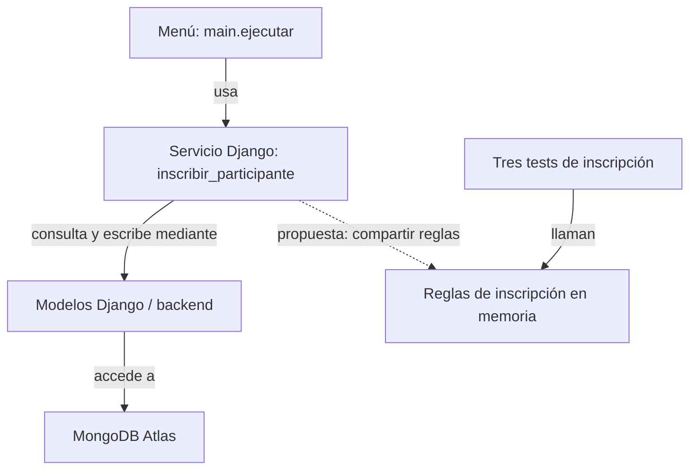

# Sesión 12 — Arquitectura y verificación de la inscripción

Documentamos la inscripción básica de un participante, su organización y los tres escenarios comprobados localmente y en GitHub Actions.

- **Proyecto:** Sistema de inscripciones a talleres — Inscripcion-Talleres-Django.
- **Integrantes:** Marcos Dominguez, Katrina Leigue e Ismael Diaz.
- **Fecha de revisión:** 13 de octubre de 2026.
- **Requisitos:** [Sesión 6](sesion_06_requisitos.md).
- **Modelos:** [Sesión 7](sesion_07_modelos.md).
- **Plan:** [Sesiones 8–9](sesion-08-09-plan.md).
- **Operación seleccionada:** inscribir a un participante en un taller con cupo disponible.
- **IDs y aprobación:** `TAL-CU-01` y `TAL-MOD-01` describen espera/promoción; son contexto relacionado, pero no son los escenarios completos comprobados aquí. `TAL-RF-03` aprueba el límite de espera para porcentajes enteros; no está implementado en esta operación. `TAL-RF-02` aprueba reinscripción después de cancelar, pero deja pendiente el tratamiento de duplicados activos. No se atribuye a esos IDs una cobertura que estos tests no ofrecen. Falta confirmar la trazabilidad específica de la inscripción básica y el acuerdo de duplicados.
- **Tarea que continúa:** tareas B, C y D del plan, únicamente en su parte de inscripción y verificación; no equivale a terminar el incremento de espera/cancelación/promoción. No se verificó una issue remota asociada.
- **Retroalimentación atendida:** selección de inscripción y ejecución de los tres tests existentes en CI, acordadas con Marcos en esta conversación; sin retroalimentación docente registrada.

## 1. Punto de partida y alcance

La versión integrada en `main` desde `migration/django-atlas` contiene un menú de terminal, servicios Django para persistir en MongoDB y reglas anteriores comprobables en memoria. Ya existían 19 tests en `tests/test_reglas.py`.

- **Resultado inicial observado:** `python -m pytest tests -q`: 19 aprobados, 0 fallidos, Python 3.14.7. Hubo una advertencia local al escribir la caché de pytest, sin fallos de tests.
- **Brecha atendida:** preparar CI y seleccionar explícitamente aceptación, rechazo por duplicado y último cupo de la inscripción básica.
- **Incluido:** `.github/workflows/ci-sesion12.yml`, `requirements-ci.txt`, reutilización de tres tests y documentación del contrato y sus límites.
- **No realizado:** refactorización de las reglas ni ampliación de los asserts. La actividad pide mejorar una separación o ampliar su comprobación; falta completar esa mejora para acreditar ese punto.
- **Pendiente:** lista de espera, cancelación, promoción, restricciones temporales y superposición; pruebas del servicio persistente e integración con Atlas; confirmación de políticas pendientes.

## 2. Responsabilidades y dependencias

| Componente | Responsabilidad | Código existente | Interfaz que usa |
|---|---|---|---|
| Menú | Recibir códigos y mostrar resultado/error | `proyecto/main.py`, `ejecutar()`, opción 4 | `talleres.servicios.inscribir_participante()` |
| Servicio persistente | Buscar entidades, validar duplicado/cupo y guardar | `talleres/servicios.py`, `inscribir_participante()` | Modelos Django, `cupos_disponibles()` y `transaccion_con_reintentos` |
| Modelos/almacenamiento | Definir registros y acceder a MongoDB | `talleres/models.py`, backend configurado en `config/settings.py` | ORM de Django y backend MongoDB |
| Reglas en memoria | Validar y agregar una inscripción a una lista | `proyecto/reglas_inscripciones.py`, `inscribir_participante()`; exportada por `proyecto/reglas.py` | Diccionarios, listas y objetos de datos; usada por los tests |

- **Cohesión:** el menú agrupa interacción; el servicio agrupa la operación persistente; el módulo de reglas agrupa validaciones y efectos en memoria.
- **Acoplamiento:** el menú conoce la firma y errores del servicio; el servicio conoce modelos, consultas y transacciones del backend. Los tests conocen el contrato de las reglas en memoria.
- **Separación existente:** los tests no importan el menú ni necesitan `input()` o credenciales.
- **Brecha real:** el servicio no llama a la función de inscripción en memoria; ambos implementan controles similares. Un test aprobado del módulo de reglas no asegura que el servicio conserve el mismo comportamiento.

## 3. Interfaz seleccionada

**Contrato existente que llaman los tres tests:**

```python
inscribir_participante(participante_id, taller_id, participantes, talleres, inscripciones) -> Inscripcion
```

- **Proveedor:** `proyecto/reglas_inscripciones.py`, expuesto por `proyecto/reglas.py`.
- **Consumidor comprobado:** `tests/test_reglas.py`.
- **Entradas:** IDs de participante/taller; diccionarios que contienen sus objetos; lista de inscripciones. El taller ofrece `id` y `cupos`, un número de plazas. Se supone un conjunto de datos consistente y capacidad válida.
- **Aceptación:** devuelve una `Inscripcion` confirmada y la agrega al final de la lista; la disponibilidad disminuye una plaza.
- **Rechazo/repetición:** lanza `InscripcionDuplicadaError`, `CupoAgotadoError`, `ParticipanteNoEncontradoError` o `TallerNoEncontradoError`, según la validación. Repetir una inscripción activa se rechaza en el código actual; no se presenta como acuerdo nuevo del cliente.
- **Conservación:** no debe alterar participantes, talleres ni inscripciones anteriores. Ante rechazo, no debe agregar ni modificar inscripciones.
- **Consulta/escritura en tests:** la función consulta los datos recibidos y hace `append` solo después de validar. No escribe en MongoDB.
- **Importación:** importar `proyecto.reglas` permite probar sin teclado, Django ni conexión real.

**Contrato usado por el menú:** `talleres.servicios.inscribir_participante(codigo_participante, codigo_taller)`. Busca modelos y devuelve una inscripción persistente creada mediante el ORM. Usa `transaccion_con_reintentos` para coordinar la operación; su rollback y concurrencia reales no se verifican con los tres tests seleccionados.

## 4. Vistas del mismo flujo

### Responsabilidades y dependencias



- **Flechas:** dependencia de una interfaz; no son una secuencia de mensajes.
- **Leyenda:** líneas continuas = relaciones existentes en el código; discontinua = propuesta no implementada. El acceso real a Atlas no se ejecutó en esta revisión.
- **Pregunta:** ¿qué código usa el menú y qué código verifican los tests?

### Ejecución: éxito y rechazo

- **Modelo de origen:** `TAL-CU-01` y `TAL-MOD-01` de sesión 7, apartados 2–4, como contexto de solicitud. El modelo exige taller completo y espera/promoción; no representa la confirmación directa comprobada aquí.
- **Adaptación documentada:** esta vista detalla la inscripción básica existente, sin modificar ni dar por cubierto el modelo de sesión 7. Falta validar con el equipo ese recorte de alcance.

**Éxito del menú:**

1. El operador introduce códigos de participante y taller en la opción 4.
2. El servicio consulta las entidades y abre su operación transaccional.
3. Comprueba que no exista duplicado y que haya cupo disponible.
4. Crea la inscripción mediante el ORM.
5. El menú muestra la confirmación.

**Rechazo:** una referencia inexistente, un duplicado o falta de cupo provoca una excepción; el menú la informa. La conservación en el almacenamiento real debe comprobarse con tests del servicio/backend. En los tests actuales, se llama directamente a las reglas y se observa la lista en memoria.

### Ubicación

| Elemento | Ubicación actual | Ubicación prevista |
|---|---|---|
| Menú, servicio y Django | Equipo local que ejecuta Python | Sin cambio para el uso por terminal |
| Datos persistentes | MongoDB Atlas según configuración; no consultado aquí | Sin cambio |
| Datos de los tres tests | Memoria del proceso local | Memoria del runner de Actions |
| Reporte de pruebas | XML local y artefacto de Actions aprobado | Sin cambio |

**CI:** runner `ubuntu-latest`, con Python 3.12. Es un entorno temporal de pruebas, no un servidor ni un despliegue de la aplicación.

## 5. Decisión arquitectónica y calidad

- **Objetivo:** comprobar la inscripción sin interacción por teclado y detectar fallos al subir cambios.
- **Evaluación observable:** ejecutar los tres tests y la suite anterior; revisar si el servicio y las reglas mantienen el mismo contrato.

| Alternativa | Beneficio | Trabajo adicional o límite |
|---|---|---|
| A: conservar reglas en memoria y servicio persistente separados | Permite reutilizar los tests y preparar CI inmediatamente | Validaciones duplicadas; la suite aislada no demuestra comportamiento del servicio |
| B: compartir decisiones del dominio y usar el servicio como adaptador de persistencia | Reduce divergencias y permite comprobar reglas comunes | Requiere refactorización y tests del adaptador y del backend |

- **Elección para este cambio:** A como punto de partida existente; se añadió CI. B queda propuesta para revisión, sin afirmar que fue implementada.
- **Calidad:** automatización y facilidad de prueba. No se atribuyen mejoras de rendimiento o integridad en Atlas a estos resultados.
- **Revisar la decisión si:** el servicio difiere de las reglas, se incorpora espera/promoción o aparecen errores concurrentes.

## 6. Cambio y trazabilidad de las pruebas

- **Cambio real:** workflow y dependencias de CI; commit `ecda04777d47c4be38d45db5e2d444cee1db7575` selecciona exactamente tres tests. El commit anterior `c0cf924` añadió la configuración inicial.
- **Nota de auditoría posterior:** el workflow actual ejecuta la suite completa de backend y frontend; esta sección conserva el registro histórico de la selección original de tres casos.
- **Código de negocio:** no se cambió en esta intervención.
- **Reglas:** se conserva el comportamiento existente; no se aprobaron nuevas políticas ni se editaron los requisitos/modelos.

| Referencia y limitación | Ruta | Función | Test real | Respuesta y estado esperados |
|---|---|---|---|---|
| Inscripción básica existente; ID específico pendiente de confirmar | Aceptación | `proyecto.reglas.inscribir_participante` | `test_inscribe_participante_y_confirma_la_plaza_disponible` | Cupo 2: devuelve confirmada con IDs correctos, agrega el registro y deja 1 plaza |
| Duplicado activo; pendiente según `TAL-RF-02` | Rechazo/repetición | Misma función | `test_rechaza_inscripcion_duplicada_sin_ocupar_otro_cupo` | Lanza error; queda 1 registro y 1 plaza disponible |
| Capacidad de inscripción básica; no acredita límite de espera `TAL-RF-03` | Límite: última plaza | Misma función | `test_inscripcion_en_el_ultimo_cupo_deja_el_taller_sin_disponibilidad` | Cupo 1: acepta y queda disponibilidad 0; falta assert explícito de respuesta y registro |

**Pruebas reutilizadas:** las tres ya existían y se conservaron sin modificaciones por decisión de Marcos. Se ejecutaron correctamente localmente y en CI. Sus comprobaciones son las descritas en la tabla; no verifican conservación completa mediante una copia independiente ni persistencia real en MongoDB.

**Comando local de los tres casos** (desde la raíz, con Python del entorno):

```powershell
.\.venv\Scripts\python.exe -m pytest tests/test_reglas.py::test_inscribe_participante_y_confirma_la_plaza_disponible tests/test_reglas.py::test_rechaza_inscripcion_duplicada_sin_ocupar_otro_cupo tests/test_reglas.py::test_inscripcion_en_el_ultimo_cupo_deja_el_taller_sin_disponibilidad -q -p no:cacheprovider --junitxml=evidencias/sesion12-junit.xml
```

- **Resultado final comprobado:** 3 aprobados, 0 fallidos; Python 3.14.7 y pytest 9.1.1.
- **Regresión:** `python -m pytest tests -q -p no:cacheprovider`: 19 aprobados, 0 fallidos.
- **Reporte local:** `evidencias/sesion12-junit.xml`, sin versionar; el reporte publicado está en los artefactos de Actions.
- **No comprobado:** servicio Django, transacciones y persistencia real, reinicios, simultaneidad, espera/promoción, horarios y equivalencia del servicio con reglas en memoria. La prueba local se hizo con Python 3.14.7; CI está configurado con 3.12.

## 7. Evidencia de CI y versión

- **Workflow:** [ci-sesion12.yml](../.github/workflows/ci-sesion12.yml).
- **Dependencias:** [requirements-ci.txt](../requirements-ci.txt), `pytest>=8,<10`. Los tres tests aislados no requieren Django/MongoDB; el archivo no instala la aplicación completa.
- **Disparadores:** `push`, `pull_request` y `workflow_dispatch`.
- **Comando:** `python -m pytest` con los tres identificadores de test de la sección 6, `-q --junitxml=evidencias/sesion12-junit.xml`.
- **Repositorio configurado como origin:** [Inscripcion-Talleres-Django](https://github.com/marcosedominguez-cyber/Inscripcion-Talleres-Django).
- **Página para localizar ejecuciones:** [Actions](https://github.com/marcosedominguez-cyber/Inscripcion-Talleres-Django/actions). Este enlace no sustituye la URL de una ejecución.
- **URL de ejecución verificada:** [Actions — ejecución 38490987995](https://github.com/marcosedominguez-cyber/Inscripcion-Talleres-Django/actions/runs/38490987995), en la rama main, completada correctamente. [Job aprobado](https://github.com/marcosedominguez-cyber/Inscripcion-Talleres-Django/actions/runs/38490987995/job/115615857141).
- **Commit de la ejecución de CI:** `ecda04777d47c4be38d45db5e2d444cee1db7575`, informado como `head_sha` por GitHub para esta ejecución en main.
- **Estado remoto verificado:** completed / success, consultado mediante la API de GitHub. La ejecución corresponde al commit `ecda04777d47c4be38d45db5e2d444cee1db7575`, que selecciona los tres tests. Los resultados locales también fueron 3 aprobados.
- **Reporte remoto verificado:** [resultados-sesion12-38490987995-1](https://github.com/marcosedominguez-cyber/Inscripcion-Talleres-Django/actions/runs/38490987995/artifacts/11861507796), con retención de 14 días.
- **Candidato generado y verificado en main:** [ZIP del código versionado](https://github.com/marcosedominguez-cyber/Inscripcion-Talleres-Django/actions/runs/38490987995/artifacts/11861288140), artefacto `candidato-sesion12-ecda04777d47c4be38d45db5e2d444cee1db7575`. No representa un despliegue.
- **Commit del MD:** no creado; esta edición local es posterior al commit de configuración.
- **Para ejecutar en destino:** instalar dependencias de la aplicación, configurar acceso propio a Atlas y verificar migraciones e integración. El workflow no despliega y no acredita esas comprobaciones.

## 8. Plan actualizado y participación

Este es el estado de esta revisión; no se editaron issues remotas ni se declara terminado el incremento del plan.

| Trabajo | Estado | Evidencia / falta |
|---|---|---|
| Inscripción básica en memoria | Existente y comprobada | Tres tests aprobados |
| Configuración de CI | Implementada en código | Workflow y dependencias integrados en main; Actions aprobado |
| Mejora de separación o contrato | Pendiente | Ampliar asserts o compartir reglas y comprobar adaptador |
| Espera, cancelación y promoción (B) | Pendiente en el código revisado | No existen aquí esas operaciones |
| Pruebas del incremento (C) | Pendientes | Los tests básicos no cubren espera/promoción |
| Integración y cierre (D) | En curso, sin cierre acreditado | 19 tests locales y CI aprobado; faltan integración con Atlas y revisión conjunta |

- **Riesgo actualizado:** pueden pasar los tests en memoria mientras el servicio persistente falla, porque implementan validaciones por separado.
- **Siguiente acción propuesta:** Marcos revisa y publica este MD; el equipo revisa la misma versión y confirma las políticas pendientes. Se conservan los tests actuales. Son propuestas de revisión, no aportes ya realizados.
- **Condición de cierre:** mejora real comprobada, escenarios aprobados y trazables, evidencia de CI y revisión del mismo commit por el equipo.
- **Aporte observado de Marcos:** eligió la operación y los tres tests, solicitó la configuración y la adaptación del documento. Los commits existen; no se verificó autoría ni revisión individual completa.
- **Reparto propuesto, pendiente de confirmación:** Marcos: revisión del flujo, integración en main y documentación; Katrina: revisión de los tres escenarios de prueba y sus resultados; Ismael: revisión del contrato, diagrama y relación con requisitos. Este reparto no acredita que esas revisiones ya se hayan realizado.
- **Asistencia de IA:** Codex leyó código y documentos, adaptó el workflow, creó dependencias mínimas, ejecutó tests y redactó este documento. El equipo debe revisar y poder explicar las decisiones, resultados y límites.

## 9. Enlaces de entrega

- **Documento:** `docs/sesion-12-arquitectura.md`.
- **Enlace previsto después del push:** [MD en main](https://github.com/marcosedominguez-cyber/Inscripcion-Talleres-Django/blob/main/docs/sesion-12-arquitectura.md). Esta edición todavía es local.
- **Actions:** [ejecución aprobada 38490987995](https://github.com/marcosedominguez-cyber/Inscripcion-Talleres-Django/actions/runs/38490987995).
- **Hallazgo principal:** recepción por menú y persistencia están separadas, pero los tests seleccionados comprueban una implementación en memoria distinta del servicio usado por el menú. CI automatiza aceptación, rechazo y límite; la integración real con MongoDB sigue fuera de esta evidencia.

### Revisión de la entrega

Los nueve apartados de la plantilla están documentados. Los tres tests se reutilizaron sin cambios y pasaron; el workflow, el SHA y los artefactos remotos están verificados. No se realizó una nueva separación ni ampliación de asserts: configurar CI no sustituye ese punto de la actividad. El reparto individual permanece propuesto hasta que cada integrante confirme su participación. La publicación de este MD queda a cargo de Marcos.

