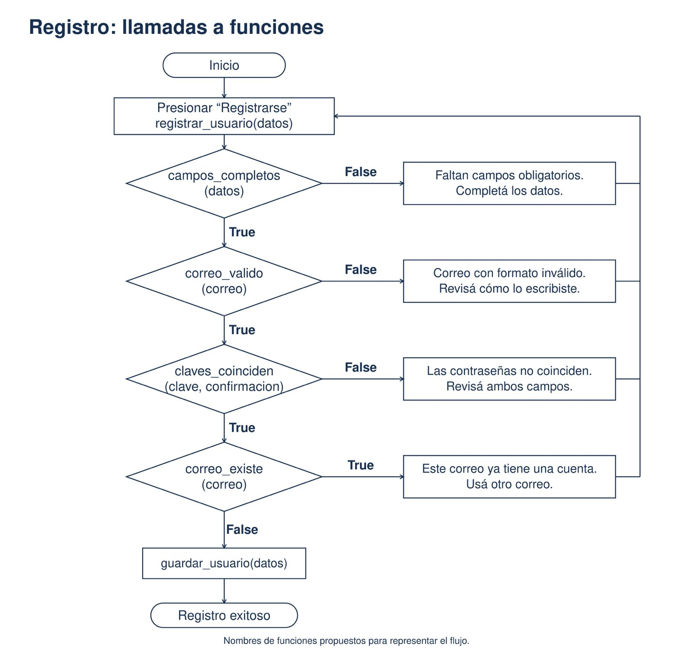
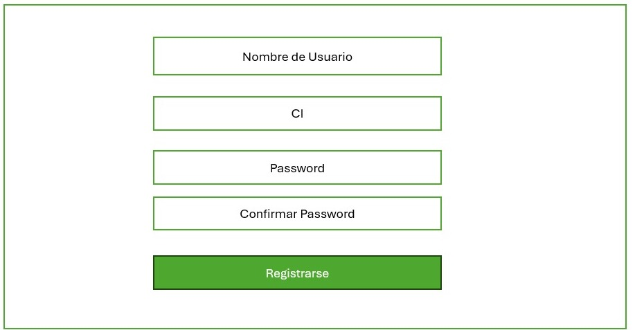
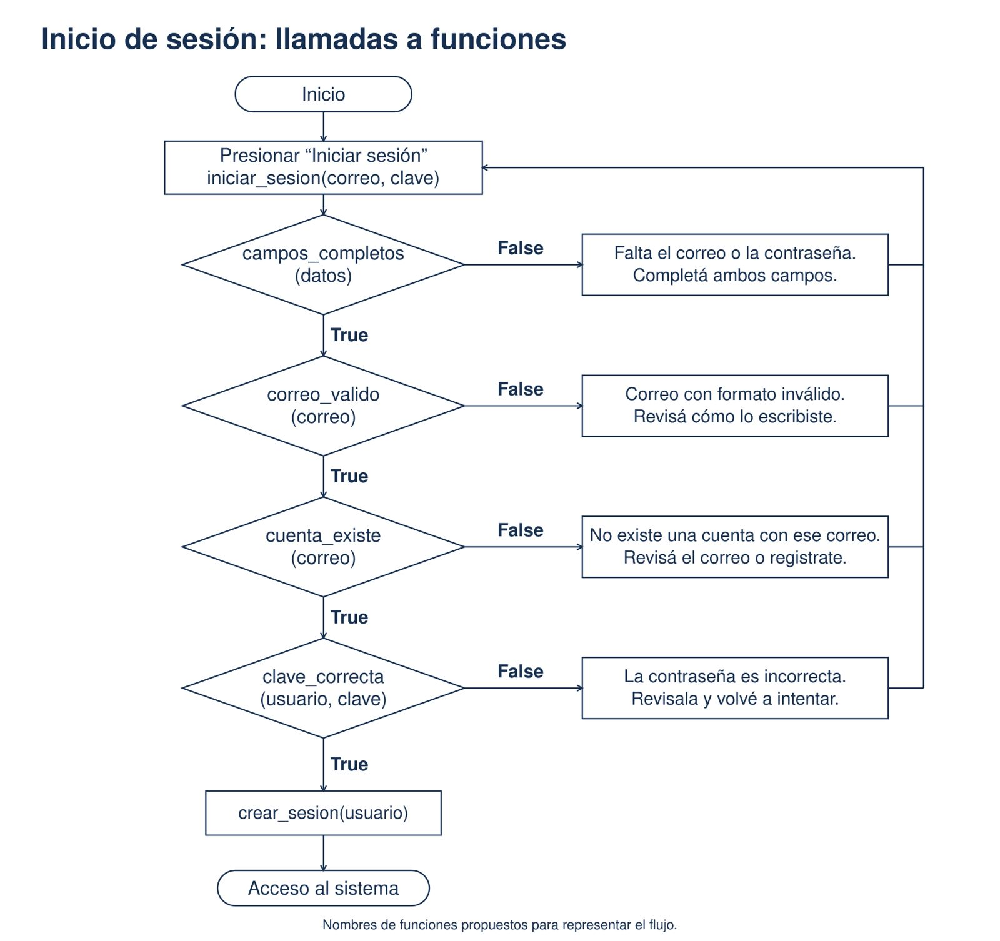
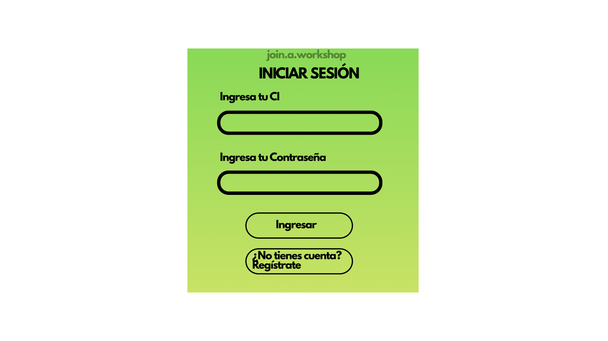

# Sesión 20: Flujos y vistas de registro e inicio de sesión

La actividad consistió en elaborar los diagramas de flujo y las vistas de registro e inicio de sesión del sistema de inscripción a talleres. Se representaron las validaciones de datos, las llamadas a funciones, los mensajes de error y el resultado exitoso de cada proceso. También se diseñaron los formularios y sus botones para mostrar cómo interactúa el usuario con el sistema.

Los diagramas usan nombres de funciones propuestos y correo como identificador; las vistas utilizan CI, como el proyecto actual. Son representaciones de diseño de la actividad.

## Flujo de registro

Validación de campos, formato del correo, coincidencia de contraseñas y cuenta existente antes de guardar al usuario.

## Vista de registro

Formulario con nombre de usuario, CI, contraseña, confirmación y botón para registrarse.

## Flujo de inicio de sesión

Validación de campos, formato del correo, existencia de la cuenta y contraseña antes de crear la sesión y permitir el acceso.

## Vista de inicio de sesión

Formulario con CI, contraseña, botón de ingreso y opción para registrarse.

